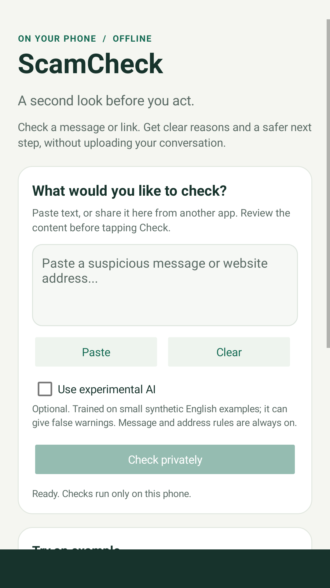
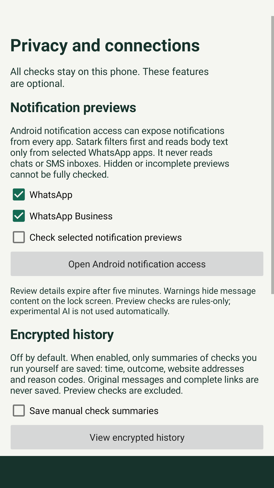
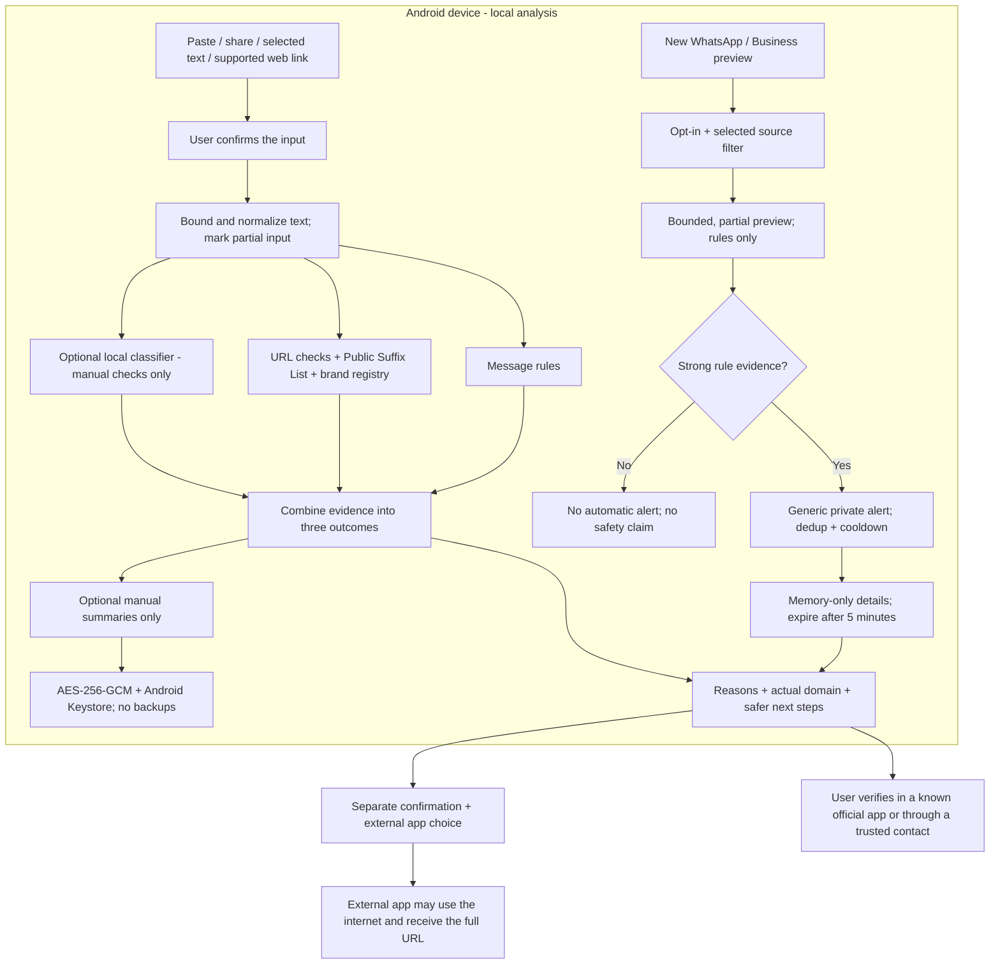
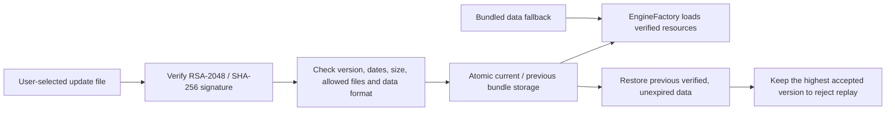

# Satark

**Think before you tap.**

Satark is an Android app that checks suspicious messages and links on your phone. It explains scam clues, shows the actual website address, and helps you choose a safer next step without uploading your conversation.

Built for **Track 2: AI-Driven Scam Pattern Recognition** in the Amazon AI Cyber Security Hackathon.

[**Download the APK - v0.4.0**](https://github.com/rohitkb11/satark/releases/download/v0.4.0/Satark-debug.apk) · [Release notes](https://github.com/rohitkb11/satark/releases/tag/v0.4.0) · [Demo guide](docs/DEMO_GUIDE.md) · [Test report](docs/PHASE_4.md)

> **MVP status:** Android 8.0+; development APK. Offline checks and Android integration have been tested on an emulator. Real WhatsApp behaviour, physical-phone performance and independent scam evaluation still need validation. A warning is a reason to verify, not proof of fraud; no warning is not a safety guarantee.

## What it does

| Feature | How it works |
| --- | --- |
| Private message checks | Paste, share or send selected text. Review the input before tapping **Check privately**. |
| Scam workflow clues | Checks credential requests, account pressure, refund fees, remote-app requests, UPI collect-to-receive and QR-to-receive patterns. |
| Link explanations | Shows the true domain and checks misleading subdomains, userinfo, unfamiliar addresses, international characters and shorteners. |
| Optional local AI | A small on-device text classifier can request extra review. It is off by default and never creates a strong warning by itself. |
| Notification previews | With separate consent and Android access, checks visible body previews from selected WhatsApp and WhatsApp Business apps. Strong rule evidence can trigger a private warning. |
| Encrypted history | Off by default. Saves only manual-check summaries, with individual/all deletion. No original messages or complete links are saved. |
| Offline data updates | Imports signed website/model data, checks version and expiry, and supports rollback while retaining the highest accepted version. |

### Three clear outcomes

- **Strong warning:** combined rule evidence suggests a risky request. Pause and verify independently.
- **Needs checking:** weak, incomplete or uncertain evidence needs a second look.
- **No warning signs found:** the checker found no supported clues. It has not proved the message or website safe.

## App preview

<table>
  <tr>
    <td align="center"><strong>Private checking</strong></td>
    <td align="center"><strong>Privacy controls</strong></td>
  </tr>
  <tr>
    <td></td>
    <td></td>
  </tr>
</table>

Actual app screens; preview/export helpers exist only in the test APK.

## Architecture

### Checking and user decisions



AI cannot erase rule findings or turn a message into a safe verdict. Message and address evidence are kept separate so correlated URL clues are not counted as several independent signals. Notification previews never use the experimental model or write history.

### Trusted offline updates



Updates contain data, not executable code. A valid signature proves trusted source and integrity, not detection accuracy. Expiry relies on the device clock; clearing app storage resets local version history. The development publisher's private key is excluded from Git and the APK.

### Main components

| Component | Responsibility |
| --- | --- |
| `MainActivity`, `LinkGate` | Confirmed input, worker-thread checks, stale-result cancellation and cautious external handoff. |
| `PrivacyActivity`, `LocalSettings` | Separate consent, selected sources, permissions, history and update controls. |
| `ScamChecker`, `MessageChecks`, `UrlChecks` | Rule evidence, URL analysis, explicit uncertainty and final outcomes. |
| `LocalTextModel`, `AssistedChecker` | Optional local inference with limited authority over results. |
| `PreviewListener`, `PreviewAlerts` | Selected partial previews, rules-only warnings and expiring memory-only details. |
| `EncryptedHistory` | Bounded encrypted manual summaries and deletion. |
| `SignedUpdate`, `UpdateStore`, `EngineFactory` | Signature validation, atomic activation, rollback and resource fallback. |

## Install and try it

1. [Download `Satark-debug.apk`](https://github.com/rohitkb11/satark/releases/download/v0.4.0/Satark-debug.apk) on an Android 8.0+ phone.
2. If Android asks, allow installation from the source you used to download it, then install the APK.
3. Paste or share a suspicious message into Satark, review it, and tap **Check privately**.
4. Read the reasons and actual domain. Verify through the organisation's official app or a contact you already know.

**Optional notification checks:** Open **Connections, history and updates**, select WhatsApp and/or WhatsApp Business, read and agree to the disclosure, then grant Android notification access. Android 13+ also requires notification permission to display warnings. Monitoring can be stopped in Satark or revoked in Android settings.

**Optional history:** Enable it only if you want encrypted summaries. Turning it off deletes the summary file and key. Clearing the input does not delete saved summaries.

For a safe walkthrough, use the synthetic examples in the app and the [demo guide](docs/DEMO_GUIDE.md). Do not open suspicious demo links or send payments.

### APK integrity

The release includes `SHA256SUMS.txt`. The v0.4.0 APK SHA-256 is:

```text
89e474980fc63cc15bcfb484f7f0546067f84904827e3f1596f8901318652b6d
```

This is a debug build with the application ID `in.scamcheck.app`. The older package name is retained for compatibility with existing installs.

## Privacy and boundaries

- No INTERNET, SMS, contacts or storage permission; no account, ads or telemetry.
- Android notification access is broad. Satark filters the selected package before reading body text; it does not read full chats or SMS inboxes.
- Previews can be hidden, redacted, grouped or incomplete. The app checks only the content Android exposes and marks it as partial.
- Alerts hide message content. Details stay in memory for up to five minutes and disappear when the process stops.
- Optional history saves time, outcome, method, website addresses and reason codes, up to 50 summaries. Addresses can still reveal interests; consent explains this.
- Keystore encryption, backup exclusions and protected screens reduce exposure. Hardware-backed key storage depends on the device.
- The app never fetches a submitted site, follows redirects, checks live DNS/TLS, authenticates a sender or blocks a payment.
- Link handling depends on Android and the source app. An internal browser may bypass Satark; share/paste remains the fallback.
- The supported language is English. The brand registry is small, and no real malicious-domain feed is bundled.
- Alert deduplication and a two-minute cooldown reduce bursts but can also suppress useful warnings.

## Evaluation

**Engineering evidence only:** 56 authored synthetic scenarios, created with knowledge of the implementation. These results are not independent or real-world fraud accuracy. “Review” combines Needs checking and Strong warning. Eight unknown cases are excluded from the scam/benign counts below.

| Measure | Rules only | Rules + optional AI |
| --- | ---: | ---: |
| Scam examples requested for review | 19 / 24 | 24 / 24 |
| Missed scam examples | 5 | 0 |
| Benign examples requested for review | 4 / 24 | 6 / 24 |
| Strong warnings on benign examples | 0 / 24 | 0 / 24 |
| Warm check p95, Android API 26 emulator | 28.12 ms | 30.87 ms |

AI remains off by default because it increased benign reviews. Emulator timing used 100 warm checks per mode and does not establish phone latency or battery use.

**Passed checks:** 87 core assertions, 12 API 35 interface tests and 12 installed-app API 26 tests. Installed-app tests ran offline and used a synthetic sender to exercise Android's notification contract; they did not test WhatsApp's actual UI.

[Full evidence and limits](docs/PHASE_4.md) · [Machine-readable evaluation](evaluation/) · [Model card](model/MODEL_CARD.md) · [Validation history](docs/VALIDATION.md)

## Technology stack

| Technology | Use |
| --- | --- |
| Java 17 | Offline engine and native Android app logic. |
| Android SDK 35; minimum API 26 | UI, sharing, notifications, Keystore and local storage. |
| Hashed text features + logistic regression | Small optional local message classifier; no cloud model or LLM. |
| Python | Synthetic model training and evaluation tooling. |
| Gradle | Android/Java builds and dependency management. |
| JUnit, Robolectric, AndroidX Test | Core, interface and installed-app verification. |

## Build from source

Install a compatible JDK, put `java` and `javac` on PATH, and install Android SDK 35. Set `JAVA_HOME` and `ANDROID_HOME` for your machine. Initial Gradle/dependency setup needs internet access; checking messages in the built app does not.

### Windows / PowerShell

```powershell
git clone https://github.com/rohitkb11/satark.git
cd satark

# Core checks, optional-model checks and signed-update checks
.\scripts\build.ps1 -Test -Demo

# Build APK, run interface tests and lint
.\scripts\android-build.ps1 -Test -Lint

# Reproduce the fixed synthetic comparison
.\scripts\evaluate.ps1
```

The APK is written to `output/Satark-debug.apk`, with a legacy `ScamCheck-debug.apk` alias. `local.properties` is generated locally and excluded from Git.

For installed-app tests, use a disposable emulator and build/install the `fixture` and `androidTest` APKs. Tests reset app-owned history/update data. See [reproduction instructions](docs/PHASE_4.md#reproduce-and-package). Signed demo fixtures expire; generating replacements requires the trusted publisher key, rather than bypassing verification.

## Repository map

```text
app/          Native Android app and interface/device tests
core/         Offline Java engine, data resources and console tools
fixture/      Synthetic notification sender for testing only
model/        Synthetic training data, evaluation and model card
evaluation/   Fixed Phase 4 scenarios, outcomes and emulator measurements
scripts/      Build, check, train, evaluate and package commands
docs/         Architecture notes, privacy limits, roadmap and demo guide
output/       Public screenshots, signed demo data and artifact checksums
```

## Team and sources

**Team ENIGMA** - Rohit Kumar, Himanshu Shukla and Ashwani Singh, Army Institute of Technology, Pune.

Code, documentation and synthetic examples were developed with AI assistance. The model uses project-authored synthetic data, not confidential customer messages or third-party weights. The bundled Public Suffix List retains its MPL 2.0 header. Brand website roots come from primary organisation sites. See [data provenance and third-party disclosures](docs/DATA_SOURCES.md).
